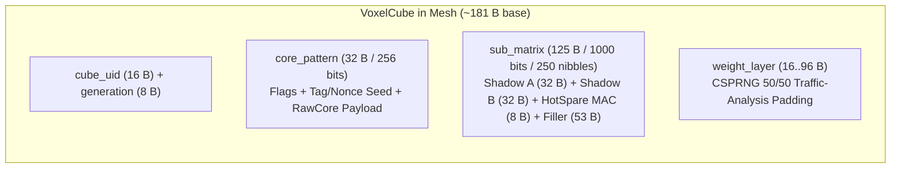
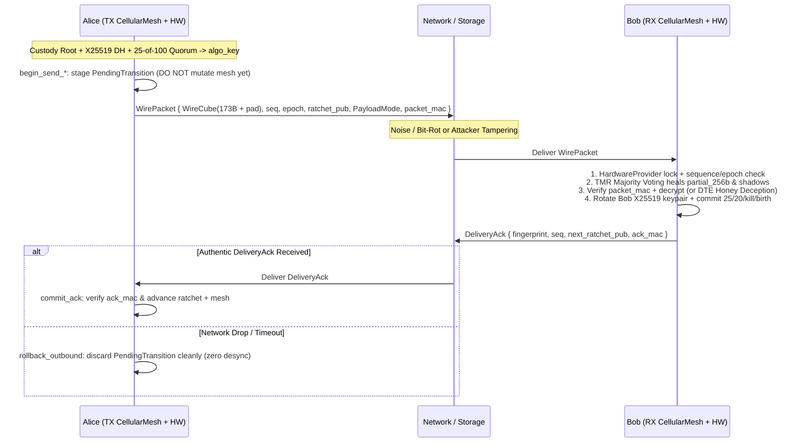

# CubeHash — Cellular 3-Cube Cryptography Engine

**CubeHash** is a standalone, general-purpose cryptographic engine implemented in pure Rust (`#![forbid(unsafe_code)]` in the core crate) with a C/C++ ABI (`cubehash-ffi`) and a built-in adversarial audit & benchmark CLI (`cubehash-cli`).

> **Release `v1.0.1`** (`MIT OR Apache-2.0`) — This repository contains **strictly the CubeHash algorithm, FFI bindings, and its verification/audit suite** — no chat server, UI, or transport application code.

[](LICENSE-MIT)
[![Rust: #![forbid(unsafe_code)]](https://img.shields.io/badge/cubehash--core-forbid(unsafe__code)-brightgreen.svg)](crates/cubehash-core/src/lib.rs)

---

## Table of Contents

1. [Core Idea & Motivation](#1-core-idea--motivation)
2. [What Is Inside This Repository](#2-what-is-inside-this-repository)
3. [How CubeHash Works](#3-how-cubehash-works)
4. [Mathematical Foundations](#4-mathematical-foundations)
5. [Security Tests & Live Audit Benchmarks](#5-security-tests--live-audit-benchmarks)
6. [Quick Commands](#6-quick-commands)

Further deep dives:
- [docs/ARCHITECTURE.md](docs/ARCHITECTURE.md) — Module anatomy, state machine, rollback atomicity, and C ABI surface
- [docs/MATHEMATICS.md](docs/MATHEMATICS.md) — Formal mathematical specification, proofs of invertibility, and exact key schedule
- [docs/SECURITY_PROOFS.md](docs/SECURITY_PROOFS.md) — Cryptographic reductions ("not weaker than standard AEAD/Hash"), `HybridTriMix` combiner theorem, Welch's $|t|$ system timing audit & benchmarks
- [docs/VERIFICATION.md](docs/VERIFICATION.md) — Complete test matrix (`18` integration tests) and verified `10`-stage release audit output
- [CHANGELOG.md](CHANGELOG.md) — Release history (`v1.0.1`)
- [SECURITY.md](SECURITY.md) — Vulnerability disclosure policy & cryptographic scope
- [CONTRIBUTING.md](CONTRIBUTING.md) — Pull request rules, CI requirements & contribution workflow

---

## 1. Core Idea & Motivation

Conventional authenticated channels derive session keys from a single static secret or linear key schedule. If memory is snapshotted, bit-rot flips wire bits before verification, device state is cloned onto another host, or a decryption failure leaks a distinct error oracle, attackers gain structural leverage.

**CubeHash** combines five defensive paradigms into a cohesive, lightweight state machine (`~17.7 KB` RAM in standard 100-cube configuration):

1. **Volumetric Cellular Turnover (`25` Select / `20` Consume / `1` Kill + `1` Birth):**
   Instead of one key, both peers maintain a synchronized **mesh of 100 3D `VoxelCube`s** embedded inside a $1000 \times 1000 \times 1000$ keyed 3D coordinate space. Every committed message deterministically selects a **25-cube quorum**, mixes **20** of them non-linearly to birth **1 next-generation cube**, and retires the **oldest-generation cube** (`110` messages completely rotate every original genesis cube).
2. **Tripartite 3-Cube Hardware Custody (`MotherCube` + `MainCube` + `AuditorCube`):**
   Session root capability requires *all three* custody cubes simultaneously; any 2-of-3 subset cannot reconstruct it. Execution is further locked to a local `HardwareProvider` enclave + strictly monotonic counter (`LocalClientClockGuard`), blocking offline state cloning and replay attacks without external NTP servers. Possession of all three cubes allows clean recovery onto replacement hardware (`recover_onto_new_hardware`).
3. **Per-Message X25519 Double Ratchet:**
   Every outbound wire packet carries a fresh OS CSPRNG ephemeral `X25519` public key (`ratchet_pub`) and every verified `DeliveryAck` rotates the receiver's `X25519` identity (`next_ratchet_pub`), providing **Forward Secrecy** and **Post-Compromise Security (PCS)** layered underneath the cellular cube synthesis.
4. **In-Band TMR Bit-Rot Self-Healing Before MAC:**
   Each standard `VoxelCube` embeds two independently HMAC-masked **Triple Modular Redundancy (TMR)** shadow copies plus an **8-byte hot-spare MAC** inside its `1000-bit` (`125 B`) sub-matrix. Up to `1` flipped copy at any bit position is transparently repaired by **Bitwise Majority Voting** *before* MAC verification, recovering cleanly over noisy channels or bit-rotted storage.
5. **Zero-Oracle Honey Deception & Constant-Work Timing Hardening:**
   When using `decrypt_zero_oracle`, the receiver executes the full hardware check, TMR repair, MAC check, transition build, **and** Distribution-Transforming Encoder (DTE) decoy synthesis **uniformly without early returns or state mutation on failure**. Any forged packet, stale replay, tampered ratchet key, or cloned-device probe emits a plausible format-valid output (e.g., a 12-word BIP-39-like phrase with a real SHA-256 checksum word, or natural UTF-8 chat text) while mutating **zero** state — preventing oracle leaks and peer desync.

---

## 2. What Is Inside This Repository

```text
CubeHash/
├── crates/
│   ├── cubehash-core/      # Pure Rust algorithm engine (#![forbid(unsafe_code)])
│   │   ├── src/
│   │   │   ├── hybrid.rs       # HybridTriMix v2 complete engine (256/512-bit, XOF, streaming hasher)
│   │   │   ├── config.rs       # Resizable MeshConfig profiles (compact / standard / high_capacity)
│   │   │   ├── custody.rs      # MotherCube, MainCube, AuditorCube, ThreeCubeCustody, HardwareProvider, LocalClientClockGuard
│   │   │   ├── primitives.rs   # fixed_budget_mix (BLAKE2b/SHA3-256/HMAC-SHA256/HybridTriMix), XChaCha20-Poly1305, HKDF-SHA256, non-linear combiners
│   │   │   ├── voxel.rs        # VoxelCube (3 layers), SubCube (181B), stack-fast TMR Majority Voting + hot-spare
│   │   │   ├── spiral.rs       # 3D SpiralSpace, coprime-affine + triangular Feistel bijection, 250-nibble bijection, O(W*K) search
│   │   │   ├── honey.rs        # Decoy chain synthesis & DteEngine (Bip39ChecksumPhrase / ChatPlaintext / RawUniform)
│   │   │   ├── mesh.rs         # CellularMesh (two-tier X25519 + HybridTriMix Ratchet), DuplexCubeSession, rollback
│   │   │   └── error.rs        # Typed CubeHashError variants
│   │   └── tests/
│   │       └── security_suite.rs   # 19 comprehensive adversarial, statistical & timing proof tests
│   ├── cubehash-ffi/       # C ABI bindings (cdylib + staticlib) & include/cubehash.h
│   │   └── tests/
│   │       └── ffi_smoke.rs        # C ABI full-lifecycle, zero-oracle, & memory safety smoke test
│   └── cubehash-cli/       # Standalone 10-stage security audit, Welch |t|-timing & 550 MB/s benchmark binary
└── docs/
    ├── ARCHITECTURE.md     # Detailed system design, C ABI, rollback & epoch flow
    ├── MATHEMATICS.md      # Complete formal equations & bijectivity proofs
    ├── SECURITY_PROOFS.md  # Full Theorems 1–9, game-hopping reductions, timing & benchmark proofs
    └── VERIFICATION.md     # Full test matrix & observed benchmark output
```

### Resizable `MeshConfig` Profiles

| Profile | Mesh Size ($N$) | Quorum ($Q / C$) | Core Layer | Sub-Matrix Layer | Base Wire Cube | Weight Padding | Coordinate Space |
| --- | --- | --- | --- | --- | --- | --- | --- |
| `compact` | `40` cubes | `12` select / `9` consume | `16 B` (128 bits) | `64 B` (512 bits) | `96 B` | `8..=32 B` | $256^3$ |
| `standard` (default) | `100` cubes | `25` select / `20` consume | `32 B` (256 bits) | `125 B` (1000 bits) | `173 B` | `16..=96 B` | $1000^3$ |
| `high_capacity` | `160` cubes | `40` select / `32` consume | `64 B` (512 bits) | `256 B` (2048 bits) | `336 B` | `32..=160 B` | $2000^3$ |

---

## 3. How CubeHash Works

### 3.1 Three-Layer `VoxelCube` & Wire Representation



### 3.2 Arrival-Triggered Transaction, Atomic Rollback & Epoch Hopping



### 3.3 Bijective Epoch Hopping

On `hop_epoch` (or `hop_epoch_ratchet_tx` / `hop_epoch_ratchet_rx`), every real and decoy cube undergoes two simultaneous invertible (1-to-1) mappings keyed by `epoch_key`:
1. **3D Coordinate Bijection:** Every cube coordinate in $[0, D)^3$ moves via a modular coprime-affine transform composed with triangular Feistel cross-axis mixing (`SpiralSpace::hop_coord_bijective`).
2. **250-Nibble Bijection:** Every 4-bit nibble of `sub_matrix` (`125 B = 250 nibbles`) is shuffled via a keyed Fisher–Yates permutation (`SpiralSpace::permute_nibbles`). When TMR self-healing runs on a stored cube at `epoch > 0`, the sub-matrix is inverted cleanly with `unpermute_nibbles`, repaired via Majority Voting, and re-permuted back into `epoch`.

---

## 4. Mathematical Foundations

> Full proofs, key schedules, and equations are in **[docs/MATHEMATICS.md](docs/MATHEMATICS.md)**.

**3-Cube Capability Synthesis:**

```math
K_{\text{root}} = \text{FixedBudgetMix}\Big(\text{Algo},\; \text{HMAC}\big(K_{\text{mother}},\; \text{"3cube-root"} \parallel S_{\text{owner}} \parallel \text{cid}\big),\; P_{\text{main}} \parallel S_{\text{synth}} \parallel K_{\text{auditor}}\Big)
```

**Ratcheted Ephemeral Key Derivation:**

```math
K_{\text{ratchet}} = \text{HMAC}\Big(K_{\text{root}},\; \text{"dh-ratchet-root-v1"} \parallel K_{\text{chain}} \parallel \text{X25519}(sk, pk_{\text{peer}})\Big)
```

**Bitwise Majority Voting (TMR):** For primary byte $C_i$ and unmasked shadow copies $A_i = S_i \oplus M_{A,i}$ and $B_i = S_{L+i} \oplus M_{B,i}$:

```math
V_i = (C_i \land A_i) \lor (C_i \land B_i) \lor (A_i \land B_i)
```

Followed by hot-spare integrity verification checking Hamming distance $d_H(T_{\text{obs}}, \text{MAC}_{\text{spare}}) \le 2$ bits.

**Bijective 3D Spiral Space Transform on $(\mathbb{Z}_D)^3$:**
- *Layer 1 (Coprime Affine, $\gcd(a_k, D) = 1$):* $(x_1, y_1, z_1) = (a_x x + b_x,\; a_y y + b_y,\; a_z z + b_z) \bmod D$
- *Layer 2 (Triangular Feistel):*

```math
x_2 \equiv x_1 + F_1(y_1, z_1) \pmod D, \qquad y_2 \equiv y_1 + F_2(x_2, z_1) \pmod D, \qquad z_2 \equiv z_1 + F_3(x_2, y_2) \pmod D
```

**Constant-Work Tri-Hash Core:** `fixed_budget_mix` executes *all three* primitives (`BLAKE2b`, `SHA3-256`, `HMAC-SHA256`) for `fixed_step_budget` iterations, computes $\text{HybridTriMix}_i = b_i \oplus (s_i \lll 3) \oplus (h_i \ggg 5)$, and selects the configured target branchlessly via `subtle::ConditionallySelectable`.

---

## 5. Security Tests & Live Audit Benchmarks

Verified across **`cubehash-core` (`19/19` security & statistical tests)**, **`cubehash-ffi` (`1/1` C-ABI test)**, and **`cubehash-cli` (`10` audit, timing & comparative benchmark stages)** — see full game-hopping proofs & Theorems 1–9 in [docs/SECURITY_PROOFS.md](docs/SECURITY_PROOFS.md) and [docs/VERIFICATION.md](docs/VERIFICATION.md):

- **Zero compiler/lint warnings:** `cargo clippy --workspace --all-targets -- -D warnings` & `cargo fmt --all -- --check`
- **All tests passing (`20/20`):**
  - Resizable profile validation (`compact`, `standard`, `high_capacity`) & dual payload mode (`RawCore256` <= `24 B` + `ArbitraryCiphertext` `XChaCha20-Poly1305`)
  - `120`-message cellular lifecycle rotation (`~18,100 B` RAM, `ones_ratio ≈ 0.50`, aggregated wire Shannon entropy `7.9927 b/B`)
  - `HybridTriMix v2` full verification (`derive_subkeys`, `mix_256`, `verify_tag_256`, `digest_512`, streaming `HybridTriMixHasher` parity, `64 KiB` `expand_xof` $\chi^2 = 259.45$)
  - Two-tier high-throughput ratchet (`dh_rekey_interval = 16`) across 3 DH boundaries preserving symmetric FS, PCS, TMR healing & zero-oracle deception
  - Atomic `DeliveryAck` commit & `rollback_outbound`, TMR (`64`/`80` bit repair), Hardware lock & `3-Cube` recovery, bijective epoch hopping
  - **Cryptographic Strength & Timing Proofs:** Strict Avalanche (`49.61%`), `64 KiB` Shannon entropy (`7.99709 b/B`), Pearson $\chi^2 = 264.43$ matching `XChaCha20-Poly1305` (`255.19`) / `SHA-256` (`293.05`), and system-level `decrypt_zero_oracle` Welch $|t| \le 1.38$ (`ratio = 0.981x–0.983x`, median `185.8 us`)
- **Measured `cubehash-cli --release` Speed (`v1.0.2`):**
  - Constant tri-leg mix: `Blake2b`: `6.49 µs` | `Sha3_256`: `6.54 µs` | `HmacSha256`: `5.97 µs` | `HybridTriMix`: `5.98 µs`
  - **High-Throughput CubeHash Encrypt (`64 KiB`, `dh=64`):** **`550.3 MB/s`** (`113.57 µs/op`) — matching raw `XChaCha20-Poly1305` (`535.5 MB/s`)!
  - **Bulk Payload CubeHash Encrypt (`1 MiB`, `dh=1` per-msg X25519):** **`554.2 MB/s`** (`1.804 ms/op`)
  - **Full 100-cube E2E roundtrip (`dh=1`):** **`0.313 ms/msg`** (`512 B`) and **`0.535 ms/msg` / `116.8 MB/s`** (`64 KiB`, ~2x faster than `v1.0.1`).

---

## 6. Quick Commands

```sh
cargo clippy --workspace --all-targets -- -D warnings
cargo test --workspace
cargo run --release -p cubehash-cli
cargo build --release -p cubehash-ffi
```
