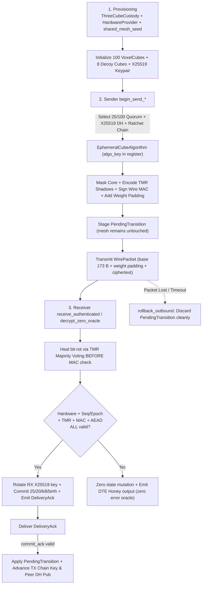

# CubeHash Engine Architecture

This document explains **what components exist** inside the `CubeHash` algorithm workspace and **how data and state flow** through each layer during provisioning, message transmission, TMR error correction, zero-oracle reception, epoch hopping, and hardware recovery.

---

## 1. Crate Structure

| Crate | Type | Unsafe Policy | Role |
| --- | --- | --- | --- |
| [`crates/cubehash-core`](../crates/cubehash-core) | Pure Rust library | `#![forbid(unsafe_code)]` | Complete cryptographic engine: 3-cube custody, hardware lock, 3D spiral space, TMR voxel cubes, X25519 ratchet, cellular mesh evolution, and DTE Honey engine. |
| [`crates/cubehash-ffi`](../crates/cubehash-ffi) | C ABI (`cdylib` / `staticlib`) | Isolated FFI boundary | Exposes opaque `CubeConfigHandle` / `CubeSessionHandle` handles and explicit `CubeBuffer` memory management in [`cubehash.h`](../crates/cubehash-ffi/include/cubehash.h). |
| [`crates/cubehash-cli`](../crates/cubehash-cli) | Binary | `#![forbid(unsafe_code)]` (uses core) | 7-stage automated security audit, fault-injection verification, and release throughput benchmark runner. |

---

## 2. Core Data Structures & Responsibilities

### 2.1 Tripartite 3-Cube Custody (`custody.rs`)

CubeHash separates root secret ownership, active chain continuity, and algorithmic policy into three independent cubes:

1. **`MotherCube`** (offline root anchor — intentionally never implements `Serialize` for wire transport):
   - Holds `master_secret: [u8; 32]` and `owner_salt: [u8; 16]`.
   - Zeroized automatically on drop (`ZeroizeOnDrop`).
2. **`MainCube`** (chain identity & progressive state anchor):
   - Holds `chain_id: [u8; 16]`, static `root_pattern: [u8; 32]`, advancing `active_chain_state: [u8; 32]`, and monotonic `generation: u64`.
3. **`AuditorCube`** (algorithmic configuration & entropy policy):
   - Holds `auditor_secret: [u8; 32]`, `synthesis_salt: [u8; 16]`, chosen `TimeAlgorithm`, chosen `CombiningFn`, coprime 3D `spiral_coeffs: [u32; 3]`, and quorum parameters (`quorum_select`, `consume_for_next`).

Combining all three produces `ThreeCubeCustody::derive_root_capability(budget)`. Missing even one field causes root synthesis to diverge completely.

### 2.2 Hardware Custody Binding (`HardwareProvider` & `LocalClientClockGuard`)

To defend against disk cloning or VM snapshot theft:
- Any host integrates a `HardwareProvider` (such as an OS enclave/TPM wrapper, `OsBoundHardwareProvider` bound to `/etc/machine-id` or Registry `MachineGuid` + OS traits + hardware secret, or `VirtualHardwareEnclave` for isolated enclaves/tests).
- `LocalClientClockGuard` seals a `32`-byte hardware capability key under label `b"cubehash-local-clock-guard-v1"` and tracks a local `local_monotonic_tick: u64`.
- Every send, receive, ACK commit, cube repair, or epoch hop invokes `authorize_local_execution(hw)`, rejecting mismatched hardware with `CubeHashError::UnauthorizedHardware` and rejecting counter rollback with `CubeHashError::ClockRollbackDetected` or `ReplayDetected`.

### 2.3 Three-Layer Volumetric Unit (`voxel.rs`)

Each slot inside `CellularMesh` stores a `VoxelCube`:

| Layer | Standard Size | Function |
| --- | --- | --- |
| `core_pattern` | `32 B` (256 bits) | Core pattern; on the wire carries `[0..2]` length, `[2]` mode flag (`0x01` RawCore / `0x02` AEAD), `[3..8]` HMAC tag (or nonce seed `[8..32]`), masked via `whitened_stream(algo_key, b"wire-core-mask")`. |
| `sub_matrix` | `125 B` (1000 bits / 250 nibbles) | Layout: `[0..32]` Masked Shadow A (`core ^ mask_a`), `[32..64]` Masked Shadow B (`core ^ mask_b`), `[64..72]` Hot-Spare 8-byte MAC tag, `[72..125]` CSPRNG/whitened 50/50 filler. |
| `weight_layer` | `16..96 B` (variable) | Random uniform length & bytes appended to transmitted wire cubes (`weight_padding`) so observers see uniform high-entropy traffic without fixed length signatures. |

### 2.4 Spatial Topology (`spiral.rs`)

`SpiralSpace` places all `mesh_size` cubes across discrete coordinates $C_i \in [0, D)^3$ (`D = 1000` in `standard`, $10^9$ voxels). Windowed lookup `lookup_spiral_window` scans only `spiral_window` (`16`) slots along the keyed spiral arm rather than scanning the entire coordinate space.

---

## 3. End-to-End Cryptographic Flow

### 3.1 Dual Payload Modes (`PayloadMode`)

1. **`RawCore256`:** Embeds compact critical secrets (`<= core_bytes - 8 = 24` bytes in `standard` mode) directly *inside* the `32`-byte core slice of the `173`-byte base `UniqueWireCube`. Both the payload bytes and shadows benefit directly from TMR Majority Voting recovery.
2. **`ArbitraryCiphertext`:** Uses `[8..]` of the generated random `plain_core` as the 24-byte nonce seed to `HKDF-SHA256`, derives a `32`-byte message key via `HKDF-SHA256(algo_key, cube_fingerprint, "cubehash-aead-payload")`, and encrypts arbitrary-length data with **`XChaCha20-Poly1305`** authenticated over a `64`-byte AAD (`cube_fingerprint || sequence || epoch || ratchet_pub`).

### 3.2 Full-Duplex Concurrency (`DuplexCubeSession`)

Because each unidirectional `CellularMesh` enforces strict `PendingTransition` gating while waiting for a `DeliveryAck`, concurrent full-duplex communication wraps two independent directional meshes inside `DuplexCubeSession { pub tx: CellularMesh, pub rx: CellularMesh }`, allowing Alice and Bob to transmit simultaneously without sequence or pending-transaction collisions.

### 3.3 Hardware Loss Recovery (`recover_onto_new_hardware`)

If a legitimate host hardware enclave is replaced, possessing all three custody cubes (`MotherCube`, `MainCube`, `AuditorCube`) derives a new `LocalClientClockGuard` bound to `new_hw`, re-sealing custody onto the replacement device while automatically locking out any copy left on `old_hw`.

---

## 4. C ABI (`cubehash-ffi`)

`crates/cubehash-ffi/include/cubehash.h` exposes the core state machine cleanly for C/C++, Python, Go, or embedded callers:
- Configuration constructors: `cubehash_config_standard`, `cubehash_config_compact`, `cubehash_config_custom`, `cubehash_config_free`.
- Session provisioning: `cubehash_provision_device` (binds OS/enclave `hw_id_16` + `hw_key_32` and optional custom seed).
- Messaging & rollback: `cubehash_send_raw_core`, `cubehash_send_message`, `cubehash_receive_authenticated`, `cubehash_receive_zero_oracle`, `cubehash_commit_ack`, `cubehash_rollback_outbound`.
- Lifecycle & diagnostics: `cubehash_hop_epoch`, `cubehash_audit_stats_json`, `cubehash_buffer_free`, `cubehash_session_free`.
